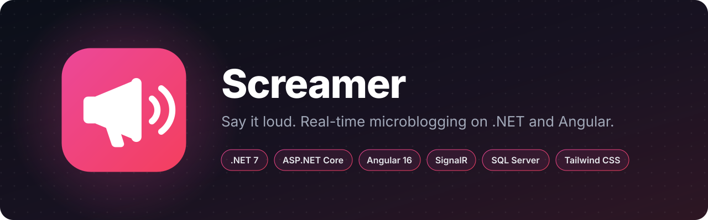
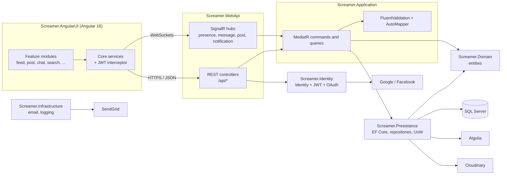

<div align="center">
  
  <p><b>A real-time, Twitter-style microblogging platform built on a Clean Architecture .NET 7 API and an Angular 16 client.</b></p>

  <p>
    
    
    
    
    
    
    
    <br />
    
    
    
    
    
  </p>

  <p><a href="#-quick-start">Quick start</a> · <a href="#-features">Features</a> · <a href="#-architecture">Architecture</a> · <a href="#-contributing">Contributing</a></p>
</div>

## Overview

Screamer is a full-stack microblogging platform for people with something to say. Users publish short posts with images, moods, hashtags and mentions, follow each other, react and reply in threads, share stories, and talk in real time over direct messages.

The backend is an ASP.NET Core 7 Web API organised with Clean Architecture and CQRS (MediatR), persisted with Entity Framework Core on SQL Server and pushed to clients over SignalR. The frontend is a lazy-loaded Angular 16 application styled with Tailwind CSS. Screamer is an actively evolving reference implementation of a social platform on the .NET + Angular stack.

## ✨ Features

| Area | What it does |
| --- | --- |
| **Authentication** | Email/password sign-up and login with ASP.NET Core Identity and JWT bearer tokens, email verification, forgot/reset/change password, account deletion, and Google and Facebook sign-in. |
| **Posts** | Rich-text composer (Quill with emoji and mention support), multiple images per post via Cloudinary, moods, categories, hashtags and user mentions. Create, edit and delete. |
| **Conversations** | Comments with nested replies, plus reactions on both posts and comments. |
| **Feeds** | Following, recent and recommended ("for you") feeds, hashtag and category feeds, trending posts, and top-performing posts and users. Infinite scroll with server-side pagination. |
| **Stories** | Image stories, listed globally or from the accounts you follow. |
| **Social graph** | Follow and unfollow, follower and following lists, user profiles with avatar and cover galleries. |
| **Bookmarks** | Save posts and browse them in a dedicated bookmarks feed. |
| **Real-time** | SignalR hubs for presence (who is online), direct messages and chat rooms, live post updates and notifications. |
| **Notifications** | Stored notifications with read/update/delete, delivered live over SignalR. |
| **Search** | Post and user search backed by Algolia, with Angular InstantSearch on the client. |
| **Developer experience** | Swagger UI in development, MiniProfiler, FluentValidation, AutoMapper profiles, and Dockerfiles plus a `docker-compose.yaml` for API, client and SQL Server. |

## 🧱 Tech stack

| Layer | Technology |
| --- | --- |
| Frontend | Angular 16, TypeScript 5, RxJS, Tailwind CSS 3, Bootstrap 5 / ngx-bootstrap, Quill (ngx-quill), ngx-infinite-scroll, ngx-toastr |
| Real-time | ASP.NET Core SignalR, `@microsoft/signalr` client |
| API | ASP.NET Core 7 Web API, Newtonsoft.Json, Swashbuckle (OpenAPI) |
| Application | MediatR (CQRS commands and queries), AutoMapper, FluentValidation |
| Identity | ASP.NET Core Identity, JWT bearer authentication, Google and Facebook external login |
| Persistence | Entity Framework Core 7, SQL Server, repository and unit-of-work pattern |
| Integrations | Cloudinary (media), Algolia (search), SendGrid (email) |
| Tooling | Docker, Docker Compose, CSharpier, MiniProfiler, xUnit and Karma/Jasmine scaffolding |

## 🏗 Architecture



Requests enter through thin controllers or SignalR hubs, which dispatch MediatR requests. Each feature lives under `Screamer.Application/Features/<Feature>Request/{Commands,Queries}`, depends only on contracts, and is fulfilled by repositories in the persistence layer.

```text
Screamer.Domain/          Entities: Post, Comment, Story, Message, ChatRoom, Follow, Notification, ...
Screamer.Application/     Contracts, DTOs, CQRS features, mapping profiles, helpers
Screamer.Identity/        Identity DbContext, auth service, JWT and external login
Screamer.Presistance/     ScreamerDbContext, EF configurations, migrations, repositories
Screamer.Infrastructure/  SendGrid email sender, logging adapter
Screamer.WebApi/          Program.cs, controllers, SignalR hubs
Screamer.AngularUI/       Angular client (core, features, shared)
```

## 🚀 Quick start

### Prerequisites

- [.NET SDK 7.0](https://dotnet.microsoft.com/download/dotnet/7.0)
- SQL Server or SQL Server Express (or the container in `docker-compose.yaml`)
- [Node.js 18](https://nodejs.org/) and npm
- EF Core CLI: `dotnet tool install --global dotnet-ef`
- Accounts for Cloudinary, Algolia and SendGrid; Google and Facebook OAuth apps if you want social sign-in

### 1. Clone

```bash
git clone https://github.com/ismailbentabett/Screamer.git
cd Screamer
```

### 2. Configure the API

Fill in the settings described in [Configuration](#️-configuration) in `Screamer.WebApi/appsettings.Development.json` (or as environment variables). Keep real credentials out of version control.

### 3. Create the database

```bash
dotnet restore
dotnet ef database update --project Screamer.Presistance --startup-project Screamer.WebApi
```

### 4. Run the API

```bash
dotnet run --project Screamer.WebApi --launch-profile api
```

The API listens on `https://localhost:5001` and `http://localhost:5000`. Swagger UI is available at `https://localhost:5001/swagger` in the Development environment.

### 5. Run the Angular client

```bash
cd Screamer.AngularUI
npm install --force
npm start
```

Open `http://localhost:4200`. The client expects the API at `https://localhost:5001` (see `src/environments/environment.development.ts`).

### Docker (optional)

```bash
docker compose up --build
```

This builds the API, the Angular dev server and a SQL Server 2022 container. Align the SQL Server password in `docker-compose.yaml` with the connection string in the root `Dockerfile` before running.

## ⚙️ Configuration

The API reads standard ASP.NET Core configuration (`appsettings*.json`, environment variables, command line). Environment variables use `__` as the section separator, for example `ConnectionStrings__ScreamerDbConnection`. Secret values are intentionally left empty in `appsettings.json`; see `.env.example` for the full list of variable names and supply real values through environment variables.

| Key | Description |
| --- | --- |
| `ConnectionStrings:ScreamerDbConnection` | SQL Server connection string |
| `JwtSettings:Key` | Signing key for JWTs (long random secret) |
| `JwtSettings:Issuer` / `JwtSettings:Audience` | Token issuer and audience |
| `JwtSettings:DurationInMinutes` | Token lifetime |
| `CloudinarySettings:CloudName` / `ApiKey` / `ApiSecret` | Cloudinary credentials for avatars, covers, post and story images |
| `EmailSettings:ApiKey` / `FromAddress` / `FromName` | SendGrid credentials and sender identity |
| `Algolia:ApplicationId` / `Algolia:APIKey` | Algolia application and API key |
| `Google:ClientId` / `Google:ClientSecret` | Google OAuth client |
| `Facebook:AppId` / `Facebook:AppSecret` | Facebook app credentials |

The Angular client is configured in `Screamer.AngularUI/src/environments/`:

| Key | Description |
| --- | --- |
| `baseWebApiUrl` | REST base URL, e.g. `https://localhost:5001/api/` |
| `baseUrl` | API origin |
| `hubUrl` | SignalR base URL, e.g. `https://localhost:5001/hubs/` |
| `ApplicationId` / `APIKey` | Algolia application ID and **search-only** key |
| `Google.ClientId` / `Facebook.AppId` | Public OAuth client identifiers |

## 📁 Project structure

```text
Screamer/
├── Screamer.sln
├── Screamer.Domain/                 # Entities and base types
├── Screamer.Application/            # CQRS features, DTOs, contracts, mapping
│   └── Features/                    # PostRequest, CommentRequest, StoryRequest, MessageRequest, ...
├── Screamer.Identity/               # Identity, JWT and external auth
├── Screamer.Presistance/            # EF Core context, migrations, repositories
├── Screamer.Infrastructure/         # Email and logging
├── Screamer.WebApi/                 # Controllers, SignalR hubs, Program.cs
├── Screamer.Application.UnitTest/   # xUnit test project
├── Screamer.Presistance.IntegrationTest/
├── Screamer.AngularUI/
│   └── src/app/
│       ├── core/                    # Guards, interceptors, models, services
│       ├── features/                # Auth, Feed, Post, Chat, Search, Trending, ...
│       └── shared/                  # Reusable UI components
├── Dockerfile                       # API image
└── docker-compose.yaml              # API + client + SQL Server
```

## 🗺 Roadmap

- [x] Clean Architecture API with CQRS, EF Core and SQL Server
- [x] JWT auth, email verification and Google/Facebook sign-in
- [x] Posts, comments, replies, reactions, bookmarks and stories
- [x] SignalR presence, direct messages and notifications
- [x] Algolia-powered search
- [x] Docker support
- [ ] Unit and integration tests for the application and persistence layers
- [ ] Continuous integration workflow (build, lint, test)
- [ ] Live view counts and new-post updates in the feed
- [ ] Notifications for tags and mentions
- [ ] Video uploads
- [ ] Polished chat layout and typing indicators
- [ ] Password management for social-login accounts

## 🤝 Contributing

Contributions are welcome. Please read [CONTRIBUTING.md](CONTRIBUTING.md) for the workflow and conventions, and follow the [Code of Conduct](CODE_OF_CONDUCT.md).

## 🔒 Security

Please do not open public issues for security problems. See [SECURITY.md](SECURITY.md) for how to report a vulnerability privately.

## 📄 License

Released under the [MIT License](LICENSE).

---

<div align="center">
  <p>Built by <a href="https://github.com/ismailbentabett">Ismail Bentabett</a> · <a href="https://ismailbentabett.com">ismailbentabett.com</a></p>
  <p>⭐ Star this repo if you find it useful</p>
</div>
